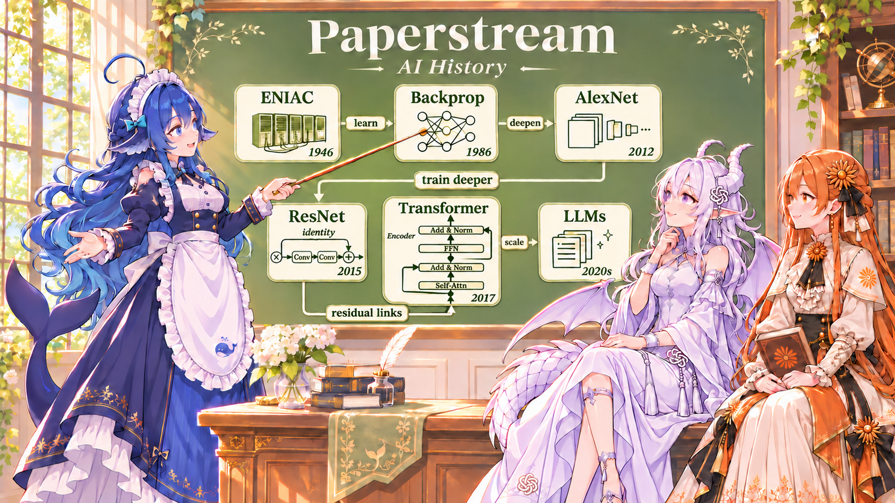
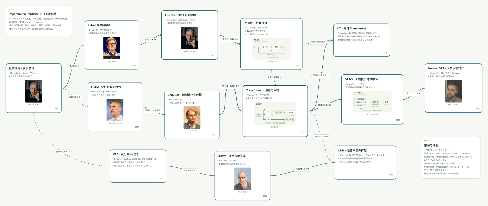
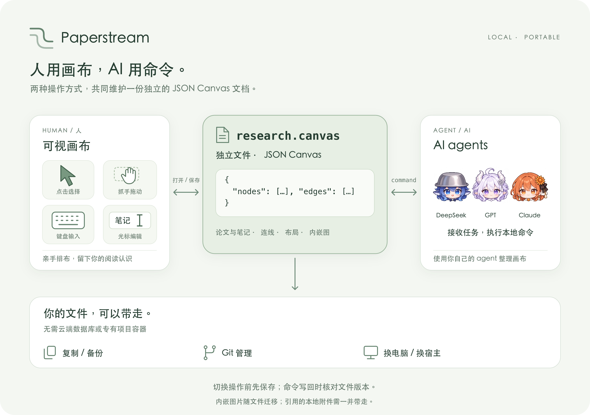

<div align="center">

# Paperstream

[中文](README.md) · **English**

**Humans curate research threads on a visual canvas; AI maintains them via local commands — sharing a single standalone `.canvas` file.**

A [JSON Canvas 1.0](https://jsoncanvas.org/spec/1.0/) paper-graph workbench paired with a zero-dependency Python API: open it directly in your **browser**, or integrate it into Agent Harnesses including **Claude Code, Codex / ChatGPT, Claude Desktop (MCP Apps), and DeepSeek Harness (DSH)**.

**[Try the Live Workbench → https://hello-jl.github.io/paperstream/](https://hello-jl.github.io/paperstream/)**

<sub>Local file storage: reads and writes `.canvas` files directly on your machine</sub>

</div>



<p align="center"><sub>AI-generated illustration; character designs reference community mascots such as ZipZipPipe (Fat-Tail Fox). See <a href="docs/assets/paperstream-classroom-promo-v4-prompt.md">sources & licensing notes</a>.</sub></p>

## Why Paperstream

Once you have read a dozen or dozens of papers, existing tools each solve only half of the problem:

- **Reference managers (e.g., Zotero)**: Great at storing PDFs and bibliographies, but make it hard to see cross-paper methodological evolution and technical branching on one canvas.
- **Automated citation graphs (e.g., Connected Papers)**: Great at surfacing similar papers via co-citation, but "cited / similar" is not the same as the mechanistic judgment you form after close reading.
- **Having AI rewrite raw whiteboard JSON directly**: Without paper-card semantics or stable IDs, whole-file rewrites easily scramble manual layouts or clobber unsaved edits.

Paperstream unifies **compact paper cards**, **directed relations with evidence**, and **validation-guarded local CLI/API tools** inside one standalone `.canvas` file.



<p align="center"><sub>Exported directly from <a href="examples/deep-learning-history.canvas">deep-learning-history.canvas</a>. Portrait and diagram credits are listed in the <a href="docs/research/deep-learning-history-sources.md">attribution manifest</a>.</sub></p>

## How It Works & Core Capabilities



<p align="center"><sub><a href="docs/assets/paperstream-architecture.svg">View source SVG</a> · Chibi avatars based on ApprenTice community artwork (CC BY-NC-SA 4.0); see <a href="docs/assets/paperstream-agent-avatars-prompt.md">attribution records</a>.</sub></p>

- **Canvas tailored for research reading**: Paper cards highlight short aliases, takeaways, key figures, and years, keeping full paper titles and source URLs neatly tucked inside contextual details; supports lightweight Notes and multi-edge shared relation labels.
- **Traceable relations & precision layout**: Annotate directionality, arrowheads, stroke styles, relation evidence, and manual weights; includes smart ELK vertical layout, manual waypoint routing, local neighborhood focus, and full-graph SVG / PNG export covering off-viewport nodes.
- **Guarded local command interface**: Zero-dependency Python API / CLI and standard MCP tools add, update, and delete nodes/edges by stable ID while preserving manual positions, Notes, and unknown extensions; disk snapshot checks, cooperative locks, and atomic writes prevent concurrent overwrites.
- **Single-file & lock-in-free**: Built on standard [JSON Canvas 1.0](https://jsoncanvas.org/spec/1.0/) with pasted images embedded directly in `.canvas`, making graphs trivial to copy, back up, version in Git, or move across hosts (one-way export supported for legacy `.mmd` files).

You can use the canvas standalone in a browser or integrate it into your favorite Agent Harness (Claude Code, Codex, Claude Desktop / standard MCP Apps, DeepSeek Harness, or any terminal Agent supporting Skills and local commands); all entry points operate on the same local `.canvas` file. For operations and format details, see the [User Guide](docs/guide.md).

## Quick Start

### 1. Open the Online Workbench (Recommended First Step)

Open **[https://hello-jl.github.io/paperstream/](https://hello-jl.github.io/paperstream/)**:

- **Local file storage**: Create, open, and save `.canvas` files directly on your disk (or load starter graphs from [examples/](examples/)).
- Supports multi-tab switching, double-click in-place editing, smart ELK vertical layout, `Ctrl/Cmd+V` image pasting, local draft recovery, and full-graph SVG / PNG export.
- Reads and writes local `.canvas` files directly in browsers supporting the File System Access API (Chrome / Edge); other browsers support exporting or downloading copies. Whenever you add local CLI tools or an AI Agent later, they share that exact same file on disk.

### 2. Let Your AI Agent Handle Local Setup

To integrate Paperstream into your Agent Harness (Claude Code, Codex, Claude Desktop / MCP Apps, DeepSeek Harness, etc.) or configure local CLI tools, let your Agent inspect your environment and install it by sending this prompt (see [`DEPLOY.md`](DEPLOY.md) for setup and fallback rules):

> Read `DEPLOY.md` in `https://github.com/hello-jl/paperstream`, check my local machine environment and workflow, and explain which local installation options fit best (e.g., prebuilt GitHub Release bundles vs. building from source); wait for my confirmation before configuring anything.

To install manually, download the portable package for your target host from [GitHub Releases](https://github.com/hello-jl/paperstream/releases) or follow the steps in [`DEPLOY.md`](DEPLOY.md).

### 3. Collaborate on the Same Graph with Humans & Agents

One `.canvas` file can be sketched and arranged manually on the canvas, then maintained in batches by an AI Agent or local commands — switching seamlessly between human editing and Agent edits at any time.

```sh
# Inspect the full document and retrieve stable node / edge IDs (use `paperstream` instead of `python3 -m paperstream` after global install)
python3 -m paperstream show examples/resnet.canvas --raw

# Perform targeted updates by stable ID
python3 -m paperstream update-node /path/to/papers.canvas <NODE_ID> --alias 'ResNet'
python3 -m paperstream add-edge /path/to/papers.canvas <SOURCE_ID> <TARGET_ID> --relation 'Reuses residual connections'
```

<details>
<summary>Expand to view batched atomic Python updates & Agent prompt example</summary>

Related edits can be validated together and saved atomically in a single `CanvasGraph` session:

```python
from paperstream import CanvasGraph

with CanvasGraph.load("/path/to/papers.canvas") as graph:
    transformer = graph.add_node(
        "Transformer",
        "- Replaces recurrence and convolution with self-attention for parallel sequence modeling\n- Wraps sublayers with residual connections",
        name="Attention Is All You Need",
        url="https://arxiv.org/abs/1706.03762v1",
        year=2017,
        x=320,
        y=480,
    )
    graph.add_edge("<RESNET_NODE_ID>", transformer.id, "Reuses residual connections")
    graph.validate()
```

When asking a local Agent to organize new papers, attach [`skills/paperstream/`](skills/paperstream/SKILL.md) and prompt:

> Following the guidelines in `skills/paperstream`, add these papers and their relationships into `/path/to/papers.canvas`, keeping my existing card layout and notes intact; leave uncertain publication years or URLs blank.

</details>

For full subcommands, conflict handling, and conventions, see the [API Reference](skills/paperstream/references/api.md), [Agent Skill](skills/paperstream/SKILL.md), and [Repository Agent Conventions](AGENTS.md).

## Browser Workbench & Agent Harness Integrations

Paperstream runs directly in the browser and integrates across Agent Harnesses (Claude Code, Codex, Claude Desktop / MCP Apps, DeepSeek Harness, and general terminal Agents), all sharing the same editor and `.canvas` format:

| Use Case | Recommended Entry | Documentation |
| --- | --- | --- |
| Sketch graphs directly or manage multiple local canvases in the browser | **Standalone Browser Workbench** ([Open Online](https://hello-jl.github.io/paperstream/) / local `web/`) | [User Guide](docs/guide.md#开始使用) |
| Bind a single on-disk `.canvas` file to a local web UI (with auth token & conflict lock) | **Single-File Local Bridge** (`python3 -m paperstream serve`) | [Local Bridge Guide](docs/guide.md#直接绑定一份本地文件) |
| Invoke tools and embed the canvas inside shell-free desktop chats (e.g., Claude Desktop) | **Standard MCP Apps** (`mcp/`, local stdio) | [MCP Integration Guide](mcp/README.md) |
| Update and preview graphs alongside Skills in terminal or desktop Code sessions | **Claude Code Plugin** (`claude/`) | [Claude Code Notes](claude/README.md) |
| Open `.canvas` files in a native desktop sidebar panel | **ChatGPT / Codex File Panel** (`codex/`) | [Codex Adapter Notes](codex/README.md) |
| Run persistently inside the DeepSeek Harness Web main panel | **DSH Web Plugin** (`dsh/`) | [DSH Plugin Notes](dsh/README.md) |

For runtime requirements and integration boundaries, see [Host Support & Verification Scope](docs/guide.md#宿主支持与验收范围) and [Agent Interaction Design](docs/research/agent-interaction-audit.md).

## Curated Canvas Examples

`examples/` includes three complete historical survey canvases ready to explore or extend in the workbench:

| Example | Overview | Attribution |
| --- | --- | --- |
| [deep-learning-history.canvas](examples/deep-learning-history.canvas) | 15 cards · 15 edges: 1986–2022 Vision, Language & Generative threads (portraits + schematic diagrams) | [Sources](docs/research/deep-learning-history-sources.md) |
| [computing-ai-history.canvas](examples/computing-ai-history.canvas) | 18 cards · 12 edges: 1946–2026 guided tour from electronic computing to modern AI | [Sources](docs/research/computing-ai-history-sources.md) |
| [computing-ai-history-connected.canvas](examples/computing-ai-history-connected.canvas) | 18 cards · 15 edges: continuous cross-row connectors linking 16 milestones | [Sources](docs/research/computing-ai-history-sources.md) |

## Development & Licensing

<details>
<summary>View repository structure & core test commands</summary>

```text
├── paperstream/        # Zero-dependency Python 3.10+ stdlib API, CLI & single-file local bridge
├── web/                # React Flow + ELK core editor & standalone browser workbench
├── dsh/                # DeepSeek Harness (DSH) Web main-panel plugin
├── codex/              # ChatGPT / Codex desktop file-panel adapter
├── mcp/                # Standard stdio MCP server tools & MCP Apps canvas
├── claude/             # Claude Code local plugin & portable bundle
├── skills/paperstream/ # Portable Agent Skill & API reference
├── examples/           # Curated .canvas examples & legacy .mmd archives
├── docs/               # User guides, design docs, audit records & visual assets
└── tests/              # Python unit tests, CLI & local bridge regression tests
```

```sh
python3 -m unittest discover -s tests -v   # Python API, CLI, local bridge & MCP tests
npm ci --prefix web
npm --prefix web test                      # Frontend format, layout & editor tests
npm --prefix web run test:interop          # Python / TypeScript round-trip interoperability tests
npm --prefix web run build
```

For build details and per-host checks, see [Development & Verification](docs/guide.md#开发与验证) and the [Design Document](docs/mechanisms/paperstream-design.md).

</details>

- **Original code & documentation**: [MIT License](LICENSE) (Copyright (c) 2026 Paperstream contributors).
- **Third-party dependencies & visual assets**: See [Third-Party Notices](THIRD_PARTY_NOTICES.md) for frontend packages, historical portraits, and community character credits.

Issues and PRs are welcome! If you run into trouble, please include reproduction steps, your environment details, and a minimal `.canvas` sample where possible.
