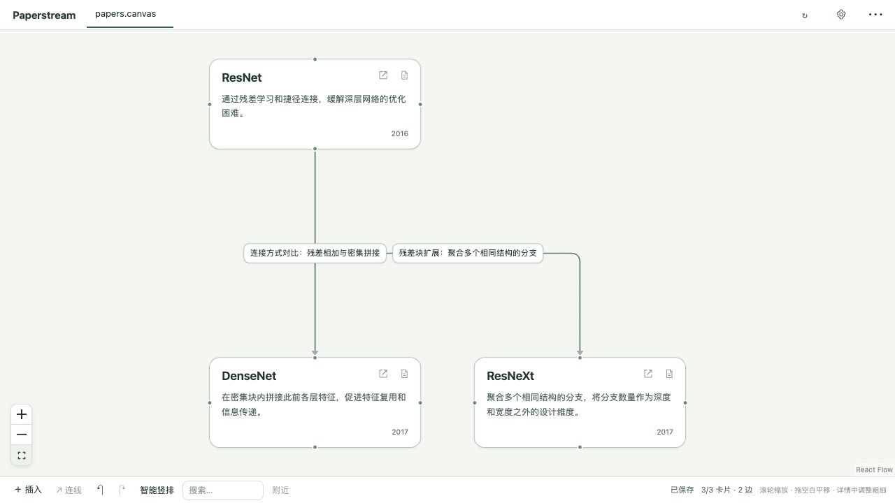

# Paperstream

**把论文读成一条研究脉络，让人和 agent 共同维护同一张图。**

Paperstream 是一个本地论文关系画布。每张卡片记下一篇论文最值得保留的认识，每条线说明两项工作之间的联系。你可以手工拖动、编辑和排版，也可以让 agent 通过 Python API 或 CLI 整理同一份 `.canvas` 文件。



## 为什么做它

论文越读越多，难点常常从“保存在哪里”变成“这篇解决了什么问题，它和之前的工作有什么关系”。单独的文献条目不容易展示脉络，长篇笔记也很难一眼比较不同方法。让 agent 直接重写画布文件，又容易丢掉手工布局、笔记和未知字段。

Paperstream 把这件事拆成两个互补的操作：**人用画布理解和调整，agent 用 API 读取和修改**。两者围绕同一份文件工作；切换操作前先保存、核对版本，有冲突就保留修改并重新核对。

- **认识优先。** 画面突出简称、takeaway、年份和关系，完整原题与原文入口放在就近详情中。
- **手工整理顺手。** 原位编辑、自动伸缩卡片、图片粘贴、竖向布局和可调整的连线，服务于真实阅读过程。
- **agent 可精确修改。** 按稳定 ID 更新指定字段，保留其余节点、坐标、顺序和未知扩展；多项相关修改可以一次保存。
- **资料是自己的文件。** 主格式为独立 JSON Canvas，Python 运行时只用标准库。编辑器不内置模型调用，也不要求云端数据库。

关系可以表示继承、比较、支持或你自己的判断；一条箭头不会自动证明引用、因果或学术贡献。Paperstream 提供记录与核对这些判断的地方，论文原文仍是依据。

## 先试一张图

构建界面需要 Node.js **22.18+**。在仓库根目录运行：

```sh
npm ci --prefix web
npm --prefix web run dev
```

打开终端显示的本机地址，从文件菜单选择一个示例：

- [ResNet、DenseNet、ResNeXt](examples/resnet.canvas)：三篇论文，适合快速了解卡片与关系。
- [CNN 演进](examples/cnn-evolution.canvas)：LeNet 等经典工作。
- [量子力学经典论文](examples/quantum-foundations.canvas)与 [DeepH 阅读路线](examples/deeph-reading.canvas)。

建议另存为自己的文件后开始整理。支持文件句柄的浏览器可保存回原文件；其他环境使用下载副本。草稿恢复不能替代正式保存。

如果希望页面直接绑定一个文件，而不使用文件选择器，可构建本地桥。还需要 Python **3.10+**：

```sh
npm --prefix claude run build
python3 -m paperstream serve examples/resnet.canvas --read-only --port 3817
```

打开命令输出的**完整本机链接**。去掉 `--read-only` 才可写入；请改用你自己的文件路径。服务仅监听 `127.0.0.1`，只授权启动时指定的文件，前台进程用 Ctrl-C 停止。该浏览器入口不需要 Claude 账号。

## 手工整理

双击简称、takeaway 或 relation 就地编辑；点击卡片的文档图标，或右键卡片／边，打开附近的详情。有效修改立即进入当前文档，**保存文件仍是单独操作**，没有“应用更改”步骤。Enter 结束单行编辑，Ctrl/Cmd+Enter 结束多行编辑，恢复已生效内容使用撤销。

| 要做什么 | 操作 |
| --- | --- |
| 新增内容 | 空白处双击或底部“插入”，选择论文、Note 或共享关系标签 |
| 连线 | 拖动连接点，或选起点后点击“连线”再点目标；说明可为空 |
| 调整关系 | 右键设置方向、双向箭头、线型、箭头形状、依据与人工权重；多条线可共用一个标签 |
| 调整重要程度 | 节点边框与关系线宽在各自详情中独立调节；权重也独立保存 |
| 加图 | 选中卡片后 Ctrl/Cmd+V，或在详情导入 PNG/JPEG/WebP；拖图片右下角调宽度 |
| 看全局 | 智能竖排、搜索、只看附近、适应视图；滚轮缩放，拖空白处平移 |
| 导出与外观 | 文件菜单导出全图 PNG/SVG；右上角设置切换主题与直角／圆角／曲线路径 |

卡片随内容增减自动调整高度，年份贴在卡片内部右下角；手动调整尺寸后可保留留白。takeaway 支持 `- ` 分点。图片默认铺满内容宽度，不显示上传文件名；每张上限 8 MB、3200 万像素、单边 16384。当前只保留 PNG/SVG 导出，不提供 PPT 或放映。

## 让 agent 帮忙整理

可以让 agent 做这样的任务：“读取这张图，把这篇论文的认识更新为我提供的三点，再补一条方法比较关系；保留已有布局和其他笔记。”先给它明确的文件路径与来源资料，保存当前 UI 修改后，再让它操作文件。

本仓库同时提供两份不同用途的约定：

- [AGENTS.md](AGENTS.md)：在这个仓库工作的 agent 应遵循的改图与开发约定。
- [Paperstream Skill](skills/paperstream/SKILL.md)：可分发的画布操作流程，带 [API 参考](skills/paperstream/references/api.md)。将整个 `skills/paperstream/` 目录安装到所用客户端的技能入口；只复制 `SKILL.md` 会丢失参考资料。Codex／Claude 插件构建产物已带入该 Skill 与 Python 启动器，单独分发 Skill 时仍需现有 Paperstream 运行时。

API 的基本用法如下。示例只修改已存在的 ID；实际 ID 要从读取结果取得：

```sh
python3 -m paperstream show examples/resnet.canvas --raw
python3 -m paperstream validate examples/resnet.canvas
# 对你自己的文件执行修改，使用上一步读到的真实 ID：
python3 -m paperstream update-node /path/to/papers.canvas ACTUAL_NODE_ID --alias '自定义简称'
```

多项相关修改使用同一个实例，校验后只保存一次：

```python
from paperstream import CanvasGraph

graph = CanvasGraph.load("papers.canvas")
# ID 来自先前对同一文档的读取；以下为占位符。
graph.update_node("ACTUAL_NODE_ID", takeaway="- 核心贡献\n- 适用边界")
graph.update_edge("ACTUAL_EDGE_ID", relation="比较两种连接方式")
graph.validate()
graph.save()
```

CLI 成功返回 JSON；失败返回非零退出码和结构化错误。API 保存检查读取时的磁盘版本，使用协作锁与原子替换；它不是实时协作或自动合并系统。遇到外改不能强行覆盖，也不能删除其他写入者的锁。完整命令见 `python3 -m paperstream --help`。

### API、MCP、Skill 分别负责什么

API 是读写与校验的内核，CLI 让有本地执行能力的 agent 调用它；Skill 告诉 agent 如何整理、核对来源和处理冲突；AGENTS.md 约束当前仓库的工作方式。

MCP 可以把 API 包装成可发现的工具，但不会自动实现这些业务规则。**当前 Codex MCP 仅提供画布 UI 资源和文件入口，没有供模型增删改图的通用工具**；Claude 接入使用 Skill、CLI 与本地文件桥。首发沿用现有 API，不再建立第二套写入逻辑。若以后需要没有 shell 的客户端接入，再考虑带版本检查的薄 MCP 工具层。详见 [交互方式审查](docs/research/agent-interaction-audit.md)。

## 在其他宿主中使用

| 入口 | 用途与当前验收范围 | 说明 |
| --- | --- | --- |
| 独立浏览器 | 完整编辑器；本地桥的真实文件读写、外改及冲突已验收 | 上面的快速开始 |
| DSH Web | 复用宿主 React 的主面板插件；macOS／Chrome／DSH 0.2.2-rc.1 已实测 | [构建、安装和限制](dsh/README.md) |
| ChatGPT／Codex 桌面文件面板 | 原生侧栏显示同一画布；本机 Codex 会话已实测编辑、撤销重做、写盘、外改与冲突 | [本地插件安装](codex/README.md) |
| Claude Code | 插件加本地 Browser 页面；包校验、隔离安装、浏览器读写通过，真实 Claude 会话待验收 | [插件与账号边界](claude/README.md) |

Codex 插件 UI 运行需 Node.js 22.18+，其 agent CLI 另需 Python 3.10+。Claude 便携包运行只需 Python 3.10+；构建仍需 web 依赖。DSH 的当前宿主版本要求 Node.js 24.9+。插件不提供模型账号，也不把 Claude Browser 入口描述成原生文件查看器。

## 文件格式与边界

主格式是 `.canvas`。论文存于标准 text 卡片的 fenced JSON，`paperstream: 1` 是模板版本，业务字段为 `name`、`alias`、`takeaway`、`url`、`year`；关系使用边的标准 `label`。`name` 保留完整原始标题，`year` 对应所链接版本；未知资料留空，不猜测年份或原文地址。

普通文本、文件卡片、链接、分组及未知字段会保留；本项目不完整复刻 Obsidian 的附件／Markdown 体验。JSON 缩进可能改变，但未请求修改的数据应保持。旧 Mermaid API 与 `.mmd` 档案保留，`export-canvas` 可单向生成新 Canvas，不自动同步或删除旧文件。

当前未完成验证的范围包括 Claude 账号内使用、DSH Desktop、其他操作系统和大规模画布。原生宿主仍观察到 ResizeObserver 循环告警，根因未解决，尚未观察到它造成保存失败。远程宿主、本地文件、浏览器草稿各有权限和版本边界，不能互相冒充。最近的检查结果与已知限制见 [验收记录](docs/mechanisms/paperstream-design.md#开源前验收2026-11-13)。

## 开发与验证

```sh
python3 -m unittest discover -s tests -v
npm --prefix web test
npm --prefix web run test:interop
npm --prefix web run build
npm --prefix dsh run build
npm --prefix dsh test
node dsh/verify-build.mjs
# 桌面适配另按各自 README 安装依赖、typecheck、build 和 test。
```

Python 运行时无第三方依赖。界面基于 React Flow，智能布局使用 ELK。构建和自动测试不能替代宿主验收；修改读写或交互行为时，请在临时副本中核对保存结果，保留冲突和失败路径的覆盖。

## 许可与贡献

本仓库自己的开源许可证尚待维护者确定；补齐 `LICENSE` 后再正式对外标注许可。第三方软件保留各自许可，见 [第三方声明](THIRD_PARTY_NOTICES.md) 和 [许可原文](licenses/third-party/)。构建产物会带入这些文件；给项目选择许可证不会替换依赖的许可。

欢迎围绕论文整理过程提交问题与小改进。报告问题时请提供可复现步骤、宿主／版本和脱敏后的最小图；不要提交本机运行目录、访问令牌、个人草稿或论文附件。格式与保存机制的设计记录维护在 [设计文档](docs/mechanisms/paperstream-design.md)。
