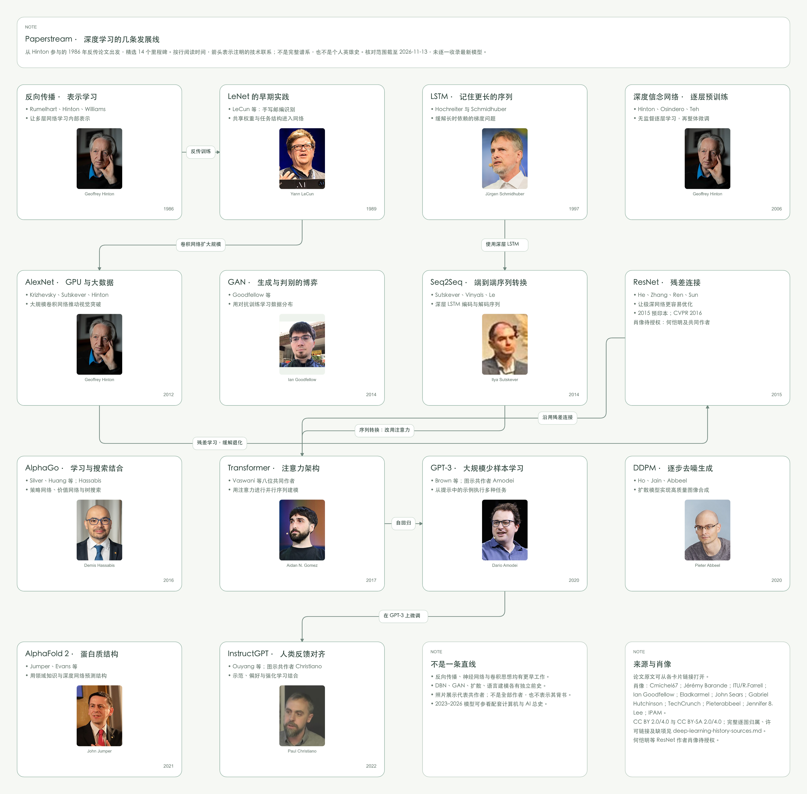

<div align="center">

# Paperstream

**人用可视画布梳理研究脉络，AI 用本地命令定点维护——共享同一份独立的 `.canvas` 文件。**

本地论文关系图编辑器（React Flow + ELK）与零依赖 Python 语义操作 API，基于开放格式 [JSON Canvas 1.0](https://jsoncanvas.org/spec/1.0/)。

**[立即在线试用工作台 → https://hello-jl.github.io/paperstream/](https://hello-jl.github.io/paperstream/)**

<sub>免安装 · 纯浏览器本地运行 · 文件不上传云端，支持直接读写本地 .canvas</sub>

[快速开始](#快速开始) · [自动部署](DEPLOY.md) · [接入方式](#按场景选择入口) · [画布样例](#精选画布样例) · [使用指南](docs/guide.md) · [API 参考](skills/paperstream/references/api.md)

</div>


<p align="center"><sub>AI 生成宣传插画，角色参考 ZipZipPipe（胖次狐）等社区拟人设定，详见<a href="docs/assets/paperstream-classroom-promo-v4-prompt.md">来源与生成记录</a>（第三方角色设定不在 MIT 许可范围内，不代表任何官方背书）。</sub></p>

## 为什么做 Paperstream

读到十几篇、几十篇论文时，现有工具各自只解决了半截问题：

- **文献管理（如 Zotero）**：擅长存 PDF 与书目，难以在一张图上看清跨论文的方法演进与技术分叉。
- **自动引文图（如 Connected Papers）**：擅长按共引发现相似论文，但“引用 / 相似”不等于精读后的机制判断。
- **让 AI 直接改通用白板 JSON**：缺少论文卡片语义与稳定 ID 操作，整文件重写容易丢掉手工排版、覆盖草稿或编造年份链接。

Paperstream 把**紧凑的论文卡片**、**有向关系与依据**以及**受校验保护的本地命令接口**收束到同一份单文件 `.canvas` 里。



<p align="center"><sub>上图直接由 <a href="examples/deep-learning-history.canvas">deep-learning-history.canvas</a> 导出（混用人物肖像与自绘原理图；分享历史画布或导出图时请附<a href="docs/research/deep-learning-history-sources.md">来源与肖像许可表</a>）。</sub></p>

## 工作原理与核心能力


<p align="center"><sub><a href="docs/assets/paperstream-architecture.svg">查看原 SVG</a> · Q 版头像基于 ApprenTice 社区派生图（CC BY-NC-SA 4.0，不在 MIT 许可范围内），见<a href="docs/assets/paperstream-agent-avatars-prompt.md">来源记录</a>。</sub></p>

- **专注科研阅读的画布**：论文卡片突出简称、要点、关键插图与年份，完整原题与原文链接收纳在就近详情中；支持轻量批注（Note）与多线共用的关系标签。
- **可溯源的关系与精细排版**：自由标注方向、箭头、线型、关系依据与人工权重；内置 ELK 智能竖排、手动折点路由、局部邻居聚焦，以及包含视口外内容的 SVG / PNG 全图导出。
- **受保护的本地命令接口**：零依赖 Python API / CLI 与标准 MCP 工具按稳定 ID 增删改查，自动保留人工布局、Note 与未知扩展；通过磁盘快照校验、协作锁与原子写盘避免静默覆盖。
- **单文件、无锁定**：基于标准 [JSON Canvas 1.0](https://jsoncanvas.org/spec/1.0/)，粘贴图片内嵌于 `.canvas` 中，可直接复制、备份、Git 管理或跨宿主迁移（旧 `.mmd` 支持单向导出）。

> [!NOTE]
> Paperstream **不内置大模型或账号，不自动联网查证论文，也不做实时无冲突共编**。人机之间通过磁盘上的 `.canvas` 文件交接——切换给 AI 前请先保存画布。完整操作说明、图片边界与格式细节见 [使用指南](docs/guide.md)。

## 快速开始

### 1. 零安装直接在线体验（推荐先试）

直接打开 **[https://hello-jl.github.io/paperstream/](https://hello-jl.github.io/paperstream/)**：

- 纯前端静态部署，**零安装、不依赖账号，文件完全在本地浏览器中处理，不上传任何服务器**。
- 支持新建或打开本地 `.canvas` 文件（例如先下载本仓库 [examples/](examples/) 下的样例）、多页签切换、双击原位编辑、ELK 智能竖排、`Ctrl/Cmd+V` 粘贴图片、IndexedDB 本地草稿恢复，以及 SVG / PNG 全图导出。
- 在支持 File System Access API 的浏览器（如 Chrome / Edge）中可直接读写本机 `.canvas` 文件，其他浏览器可导出或下载副本；后续如需搭配本机 Python 命令或 AI Agent，仍通过磁盘上的同一份 `.canvas` 文件协作。

### 2. 交给你的 AI Agent 一键部署（本地完整环境）

仓库内建零依赖部署编排脚本 [`scripts/setup.py`](scripts/setup.py) 与标准协议 [`DEPLOY.md`](DEPLOY.md)。把下面这段话直接发给你的本地 Agent（Claude Code、Codex 等），它会自动完成体检、构建、配置与冒烟验收：

> 克隆 `https://github.com/hello-jl/paperstream.git`，阅读其中的 `DEPLOY.md` 并运行 `python3 scripts/setup.py doctor --json`。根据我当前环境建议部署方案，经我确认后完成安装并验证可用。

也可自己直接执行标准 Python 安装（`pyproject.toml` 零第三方依赖）或使用统一脚本：

```sh
pip install --user -e .                   # 或 uv tool install -e .（全局注册 paperstream 命令）
python3 scripts/setup.py build --target serve
python3 scripts/setup.py install --target cli,skill,serve --apply
paperstream serve examples/resnet.canvas --read-only
```

> [!TIP]
> 本机没有安装 Node.js 22.18+ 时，可直接从 GitHub Releases 下载预构建的便携包（`serve` / `mcp` / `claude` / `codex` / `dsh`），或直接使用上方[在线静态网页版工作台](https://hello-jl.github.io/paperstream/)（由仓库 GitHub Pages 构建，数据仅在本地浏览器读写）。

### 3. 本地开发模式启动工作台（需要 Node.js 22.18+）

```sh
npm ci --prefix web
npm --prefix web run dev
```

打开终端显示的本机地址，从文件菜单载入 `examples/` 下的样例即可体验（双击原位编辑、拖拽连线、`Ctrl/Cmd+V` 贴图；写回磁盘需点击保存）。

### 4. 用本地命令或 Agent 维护同一份图（需要 Python 3.10+）

人机交接遵循三步：**① 画布先保存 → ② 交给本地命令或 Agent 按真实 ID 修改 → ③ 回画布重载检视**。

```sh
# 读取完整文档并取得真实节点 / 边 ID（已全局安装时可直接用 paperstream 替代 python3 -m paperstream）
python3 -m paperstream show examples/resnet.canvas --raw

# 按真实 ID 定点修改自己的画布（将占位 ID 替换为实际返回值）
python3 -m paperstream update-node /path/to/papers.canvas ACTUAL_NODE_ID --alias 'ResNet'
python3 -m paperstream add-edge /path/to/papers.canvas ACTUAL_SOURCE_ID ACTUAL_TARGET_ID --relation '沿用残差连接'
```

<details>
<summary>展开查看 Python 批量原子修改与 Agent 任务模板</summary>

多个相关修改可在同一个 `CanvasGraph` 实例内一次性校验并原子保存：

```python
from paperstream import CanvasGraph

with CanvasGraph.load("/path/to/papers.canvas") as graph:
    transformer = graph.add_node(
        "Transformer",
        "- 用自注意力替代循环与卷积实现并行序列建模\n- 在子层外使用残差连接",
        name="Attention Is All You Need",
        url="https://arxiv.org/abs/1706.03762v1",
        year=2017,
        x=320,
        y=480,
    )
    graph.add_edge("ACTUAL_RESNET_ID", transformer.id, "沿用残差连接")
    graph.validate()
```

把任务交给本地 Agent 时，可直接附带 [`skills/paperstream/`](skills/paperstream/SKILL.md) 规范并这样描述：

> 读取 `/path/to/papers.canvas`（使用 `show --raw`）和我提供的论文官方资料：补入新论文卡片并建立关系。请通过 `paperstream` API/CLI 按 ID 修改，保留现有布局、Note 与未知字段，缺失年份或链接留空不要编造；完成后回读校验并列出修改的 ID。

</details>

完整子命令、冲突处理与规范见 [API 参考](skills/paperstream/references/api.md)、[Agent Skill](skills/paperstream/SKILL.md) 与 [仓库 Agent 约定](AGENTS.md)。

## 按场景选择入口

所有入口复用同一编辑器与同一份 `.canvas` 格式，按你的日常工具选用：

| 使用场景 | 推荐入口 | 详细文档 |
| --- | --- | --- |
| 零安装直接画图，或在浏览器里管理多份本地画布 | **独立浏览器工作台**（[在线打开](https://hello-jl.github.io/paperstream/) / 本地 `web/`） | [使用指南](docs/guide.md#开始使用) |
| 把单份磁盘 `.canvas` 直接绑定到本地网页（带令牌与冲突锁） | **单文件本地桥**（`python3 -m paperstream serve`） | [本地桥说明](docs/guide.md#直接绑定一份本地文件) |
| 在没有 Shell 的桌面对话里调用工具并内嵌画布（如 Claude Desktop） | **标准 MCP Apps**（`mcp/`，本地 stdio） | [MCP 接入指南](mcp/README.md) |
| 在终端或桌面 Code 会话里配合 Skill 改图并预览 | **Claude Code 插件**（`claude/`） | [Claude Code 说明](claude/README.md) |
| 在桌面侧栏直接按 `.canvas` 扩展名打开原生文件面板 | **ChatGPT / Codex 文件面板**（`codex/`） | [Codex 插件说明](codex/README.md) |
| 在 DeepSeek Harness Web 主面板中长期使用 | **DSH Web 插件**（`dsh/`） | [DSH 插件说明](dsh/README.md) |

各入口的运行环境要求、已知限制与实际验收状态详见 [宿主支持与验收范围](docs/guide.md#宿主支持与验收范围) 与 [交互边界审查](docs/research/agent-interaction-audit.md)。

## 精选画布样例

`examples/` 目录随附 7 份经过 API 校验的 `.canvas` 示例，可在工作台打开并另存为自己的副本：

| 样例 | 内容概览 | 来源说明 |
| --- | --- | --- |
| [resnet.canvas](examples/resnet.canvas) | 3 篇论文 · 2 条关系：ResNet / DenseNet / ResNeXt，适合首次试用与试跑 CLI | — |
| [cnn-evolution.canvas](examples/cnn-evolution.canvas) | 4 篇论文 · 3 条关系：LeNet-5 → AlexNet ↔ VGG → ResNet（含双向对照） | — |
| [deeph-reading.canvas](examples/deeph-reading.canvas) | 4 篇论文 · 3 条关系：从 DFT 理论基础到 DeepH / DeepH-E3 的专题路线 | — |
| [quantum-foundations.canvas](examples/quantum-foundations.canvas) | 6 篇论文 · 5 条关系：1925–1964 量子力学奠基原始文献脉络 | — |
| [deep-learning-history.canvas](examples/deep-learning-history.canvas) | 17 张卡片 · 8 条关系：1986–2022 深度学习发展线（肖像＋原理图） | [来源表](docs/research/deep-learning-history-sources.md) |
| [computing-ai-history.canvas](examples/computing-ai-history.canvas) | 18 张卡片 · 12 条连线：1946–2026 从电子计算到现代 AI 导览 | [来源表](docs/research/computing-ai-history-sources.md) |
| [computing-ai-history-connected.canvas](examples/computing-ai-history-connected.canvas) | 18 张卡片 · 15 条连线：行间折线连续串起 16 个里程碑 | [来源表](docs/research/computing-ai-history-sources.md) |

<details>
<summary>展开查看导出整图：从电子计算到 AI（1946–2026）</summary>


</details>

## 开发与许可

<details>
<summary>查看仓库结构与核心测试命令</summary>

```text
├── paperstream/        # 零依赖 Python 3.10+ 标准库 API、CLI 与单文件本地桥
├── web/                # React Flow + ELK 核心编辑器与独立工作台
├── dsh/                # DeepSeek Harness (DSH) Web 主面板插件
├── codex/              # ChatGPT / Codex 桌面文件面板适配
├── mcp/                # 标准 stdio MCP 工具与 MCP Apps 画布
├── claude/             # Claude Code 本地插件与便携打包
├── skills/paperstream/ # 可独立分发的 Agent Skill 与 API 参考
├── examples/           # 精选 .canvas 示例与旧 .mmd 档案
├── docs/               # 使用指南、设计文档、审查记录与图片素材
└── tests/              # Python 单元测试与 CLI / 本地桥回归测试
```

```sh
python3 -m unittest discover -s tests -v   # Python API、CLI、本地桥与 MCP 桥接测试
npm ci --prefix web
npm --prefix web test                      # 前端格式、布局与编辑器测试
npm --prefix web run test:interop          # Python / TypeScript 往返一致性测试
npm --prefix web run build
```

更多构建与各端验证步骤见 [开发与验证](docs/guide.md#开发与验证) 与 [设计文档](docs/mechanisms/paperstream-design.md)。

</details>

- **自有代码与文档**：采用 [MIT License](LICENSE)（Copyright (c) 2026 Paperstream contributors）。
- **第三方依赖与素材**：前端依赖（含 `elkjs` 的 EPL-2.0、MCP 过渡许可声明等）、历史人物肖像及社区拟人角色素材各自保留原有许可与署名要求，详见 [第三方声明](THIRD_PARTY_NOTICES.md)。分享历史画布或导出图时请附对应来源表。

欢迎提交 Issue 或 PR 改进工作流与细节体验；反馈问题请附复现步骤、宿主版本与脱敏后的最小 `.canvas` 示例，切勿提交访问令牌、个人草稿或受版权限制的论文附件。
