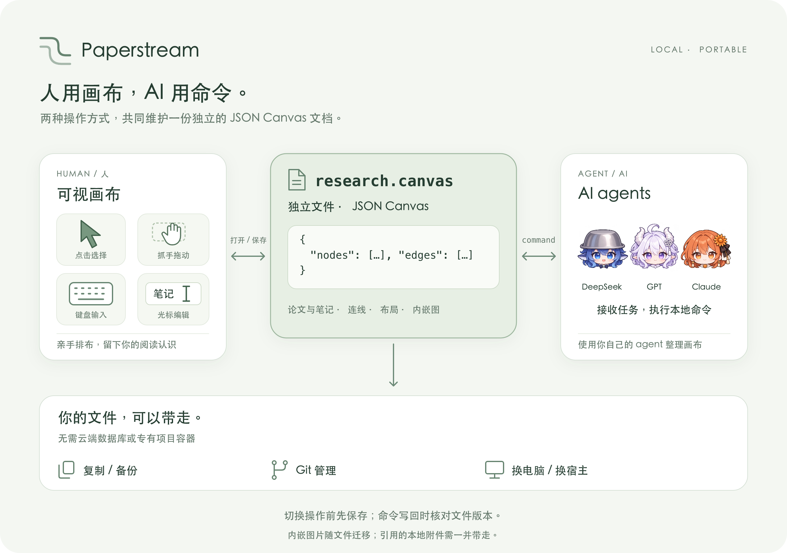

<div align="center">

# Paperstream

**中文** · [English](README.en.md)

**人用可视画布梳理研究脉络，AI 用本地命令定点维护——共享同一份独立的 `.canvas` 文件。**

基于 [JSON Canvas 1.0](https://jsoncanvas.org/spec/1.0/) 的论文关系图工作台与零依赖 Python API：支持直接在**浏览器**中打开，也可集成到 **Claude Code、Codex / ChatGPT、Claude Desktop（MCP Apps）、DeepSeek Harness（DSH）** 等各类 Agent Harness 中协同使用。

**[立即在线试用工作台 → https://hello-jl.github.io/paperstream/](https://hello-jl.github.io/paperstream/)**

<sub>本地存储文件，直接读写你电脑上的 .canvas</sub>

</div>


<p align="center"><sub>AI 生成插画，角色参考 ZipZipPipe（胖次狐）等社区设定，见<a href="docs/assets/paperstream-classroom-promo-v4-prompt.md">来源与许可说明</a>。</sub></p>

## 为什么做 Paperstream

读到十几篇、几十篇论文时，现有工具各自只解决了半截问题：

- **文献管理（如 Zotero）**：擅长存 PDF 与书目，难以在一张图上看清跨论文的方法演进与技术分叉。
- **自动引文图（如 Connected Papers）**：擅长按共引发现相似论文，但“引用 / 相似”不等于精读后的机制判断。
- **让 AI 直接改通用白板 JSON**：缺少论文卡片语义与稳定 ID，直接整文件改写容易打乱手工排版或覆写未保存内容。

Paperstream 把**紧凑的论文卡片**、**有向关系与依据**以及**受校验保护的本地命令接口**收束到同一份单文件 `.canvas` 里。


<p align="center"><sub>上图由 <a href="examples/deep-learning-history.canvas">deep-learning-history.canvas</a> 直接导出，人物肖像与原理图来源见<a href="docs/research/deep-learning-history-sources.md">归属表</a>。</sub></p>

## 工作原理与核心能力



<p align="center"><sub><a href="docs/assets/paperstream-architecture.svg">查看原 SVG</a> · Q 版头像基于 ApprenTice 社区作品（CC BY-NC-SA 4.0），见<a href="docs/assets/paperstream-agent-avatars-prompt.md">来源记录</a>。</sub></p>

- **专注科研阅读的画布**：论文卡片突出简称、要点、关键插图与年份，完整原题与原文链接收纳在就近详情中；支持轻量批注（Note）与多线共用的关系标签。
- **可溯源的关系与精细排版**：自由标注方向、箭头、线型、关系依据与人工权重；内置 ELK 智能竖排、手动折点路由、局部邻居聚焦，以及包含视口外内容的 SVG / PNG 全图导出。
- **受保护的本地命令接口**：零依赖 Python API / CLI 与标准 MCP 工具按稳定 ID 增删改查，自动保留人工布局、Note 与未知扩展；通过磁盘快照校验、协作锁与原子写盘防止并发覆盖。
- **单文件、无锁定**：基于标准 [JSON Canvas 1.0](https://jsoncanvas.org/spec/1.0/)，粘贴图片内嵌于 `.canvas` 中，可直接复制、备份、Git 管理或跨宿主迁移（旧 `.mmd` 支持单向导出）。

你可以直接在浏览器里打开画布独立使用，也可以把它集成到常用的 Agent Harness（包括 Claude Code、Codex、Claude Desktop / 标准 MCP Apps、DeepSeek Harness，以及任意支持 Skill 与本地命令的终端 Agent）；所有入口共用同一份本地 `.canvas` 文件。更多操作与格式细节见 [使用指南](docs/guide.md)。

## 快速开始

### 1. 直接在线打开工作台（推荐先试）

直接打开 **[https://hello-jl.github.io/paperstream/](https://hello-jl.github.io/paperstream/)**：

- **本地存储文件**：直接新建、打开和保存你电脑上的 `.canvas`（也可以先载入 [examples/](examples/) 里的示例图）。
- 支持多页签切换、双击原位编辑、ELK 智能竖排、`Ctrl/Cmd+V` 贴图、本地草稿恢复，以及 SVG / PNG 全图导出。
- 在 Chrome / Edge 等支持 File System Access API 的浏览器中可直接读写本地 `.canvas`；其他浏览器支持导出或下载副本。后续搭配本地命令或 AI Agent 时，依然共享你硬盘上的同一份文件。

### 2. 让你的 AI Agent 协助本地配置

如果想把 Paperstream 集成到你常用的 Agent Harness（如 Claude Code、Codex、Claude Desktop / MCP Apps、DeepSeek Harness 等）或配置本地工具，可以把环境检查与安装直接交给 Agent，发送下面这段话（具体安装与回退规则见 [`DEPLOY.md`](DEPLOY.md)）：

> 帮我看看 `https://github.com/hello-jl/paperstream` 里的 `DEPLOY.md`，结合我当前的本机环境和使用习惯，介绍一下有哪些合适的本地安装方式（比如直接用 Releases 里的预构建包，还是从源码安装）；等我确认后再帮我配置。

如需自行配置，也可以直接从 [GitHub Releases](https://github.com/hello-jl/paperstream/releases) 下载对应宿主的预构建便携包，或按 [`DEPLOY.md`](DEPLOY.md) 中的步骤安装。

### 3. 人手操作与 Agent 操作共用同一份图

同一份 `.canvas` 既可以在画布里手动画和调整，也可以直接交给 AI Agent 或本地命令批量维护——人手编辑和 Agent 操作可以随时交替进行。

```sh
# 读取完整文档并取得真实节点 / 边 ID（全局安装后可直接用 paperstream 替代 python3 -m paperstream）
python3 -m paperstream show examples/resnet.canvas --raw

# 按真实 ID 定点修改画布
python3 -m paperstream update-node /path/to/papers.canvas <NODE_ID> --alias 'ResNet'
python3 -m paperstream add-edge /path/to/papers.canvas <SOURCE_ID> <TARGET_ID> --relation '沿用残差连接'
```

<details>
<summary>展开查看 Python 批量原子修改与 Agent 协作示例</summary>

多个相关修改可在同一个 `CanvasGraph` 实例内一次性校验并原子保存：

```python
from paperstream import CanvasGraph

with CanvasGraph.load("/path/to/papers.canvas") as graph:
    transformer = graph.add_node(
        "Transformer",
        "- 用自注意力替代循环与卷积实现并行序列建模\n- 在子层外使用残差连接",
        name="Attention Is All You Need",
        url="https://arxiv.org/abs/1706.03762v1",
        year=2017,
        x=320,
        y=480,
    )
    graph.add_edge("<RESNET_NODE_ID>", transformer.id, "沿用残差连接")
    graph.validate()
```

请本地 Agent 整理新论文时，可以附上 [`skills/paperstream/`](skills/paperstream/SKILL.md) 并这样描述：

> 请参考 `skills/paperstream` 的规范，把这几篇论文和它们之间的关系补充进 `/path/to/papers.canvas`，保留我现有的卡片布局和批注；不确定的年份或链接先留空即可。

</details>

完整子命令、冲突处理与规范见 [API 参考](skills/paperstream/references/api.md)、[Agent Skill](skills/paperstream/SKILL.md) 与 [仓库 Agent 约定](AGENTS.md)。

## 浏览器使用与 Agent Harness 集成

Paperstream 既支持在浏览器中直接打开，也支持集成到不同 Agent Harness（包括 Claude Code、Codex、Claude Desktop / MCP Apps、DeepSeek Harness 及通用终端 Agent）；所有入口复用同一套编辑器与同一份 `.canvas` 格式：

| 使用场景 | 推荐入口 | 详细文档 |
| --- | --- | --- |
| 直接画图，或在浏览器里管理多份本地画布 | **独立浏览器工作台**（[在线打开](https://hello-jl.github.io/paperstream/) / 本地 `web/`） | [使用指南](docs/guide.md#开始使用) |
| 把单份磁盘 `.canvas` 直接绑定到本地网页（带令牌与冲突锁） | **单文件本地桥**（`python3 -m paperstream serve`） | [本地桥说明](docs/guide.md#直接绑定一份本地文件) |
| 在没有 Shell 的桌面对话里调用工具并内嵌画布（如 Claude Desktop） | **标准 MCP Apps**（`mcp/`，本地 stdio） | [MCP 接入指南](mcp/README.md) |
| 在终端或桌面 Code 会话里配合 Skill 改图并预览 | **Claude Code 插件**（`claude/`） | [Claude Code 说明](claude/README.md) |
| 在桌面侧栏直接按 `.canvas` 扩展名打开原生文件面板 | **ChatGPT / Codex 文件面板**（`codex/`） | [Codex 插件说明](codex/README.md) |
| 在 DeepSeek Harness Web 主面板中长期使用 | **DSH Web 插件**（`dsh/`） | [DSH 插件说明](dsh/README.md) |

各入口的环境要求与接入细节见 [宿主支持说明](docs/guide.md#宿主支持与验收范围) 与 [Agent 交互设计](docs/research/agent-interaction-audit.md)。

## 精选画布样例

`examples/` 中提供以下三份较完整的历史脉络示例，可以直接在工作台里打开体验或基于它们继续修改：

| 样例 | 内容概览 | 来源说明 |
| --- | --- | --- |
| [deep-learning-history.canvas](examples/deep-learning-history.canvas) | 15 张卡片 · 15 条关系：1986–2022 视觉、语言与生成三脉演进（肖像＋原理图） | [来源表](docs/research/deep-learning-history-sources.md) |
| [computing-ai-history.canvas](examples/computing-ai-history.canvas) | 18 张卡片 · 12 条连线：1946–2026 从电子计算到现代 AI 导览 | [来源表](docs/research/computing-ai-history-sources.md) |
| [computing-ai-history-connected.canvas](examples/computing-ai-history-connected.canvas) | 18 张卡片 · 15 条连线：行间折线连续串起 16 个里程碑 | [来源表](docs/research/computing-ai-history-sources.md) |

## 开发与许可

<details>
<summary>查看仓库结构与核心测试命令</summary>

```text
├── paperstream/        # 零依赖 Python 3.10+ 标准库 API、CLI 与单文件本地桥
├── web/                # React Flow + ELK 核心编辑器与独立工作台
├── dsh/                # DeepSeek Harness (DSH) Web 主面板插件
├── codex/              # ChatGPT / Codex 桌面文件面板适配
├── mcp/                # 标准 stdio MCP 工具与 MCP Apps 画布
├── claude/             # Claude Code 本地插件与便携打包
├── skills/paperstream/ # 可独立分发的 Agent Skill 与 API 参考
├── examples/           # 精选 .canvas 示例与旧 .mmd 档案
├── docs/               # 使用指南、设计文档、审查记录与图片素材
└── tests/              # Python 单元测试与 CLI / 本地桥回归测试
```

```sh
python3 -m unittest discover -s tests -v   # Python API、CLI、本地桥与 MCP 桥接测试
npm ci --prefix web
npm --prefix web test                      # 前端格式、布局与编辑器测试
npm --prefix web run test:interop          # Python / TypeScript 往返一致性测试
npm --prefix web run build
```

更多构建与各端验证步骤见 [开发与验证](docs/guide.md#开发与验证) 与 [设计文档](docs/mechanisms/paperstream-design.md)。

</details>

- **自有代码与文档**：[MIT License](LICENSE)（Copyright (c) 2026 Paperstream contributors）。
- **第三方依赖与素材**：前端依赖、历史人物肖像及社区角色素材的许可与署名见 [第三方声明](THIRD_PARTY_NOTICES.md)。

欢迎提 Issue 或 PR 一起改进 Paperstream；如果遇到问题，方便的话附上复现步骤、使用环境和最小 `.canvas` 示例会更有帮助。

## 社区与致谢

本项目认可并支持 [LINUX DO](https://linux.do/) 社区“真诚、友善、团结、专业”的开源分享精神，欢迎在社区或 GitHub Issues / PR 中交流使用体验与改进建议。
