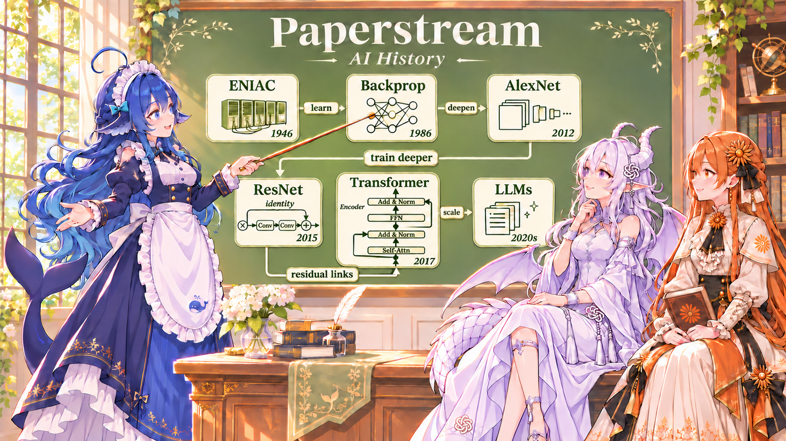
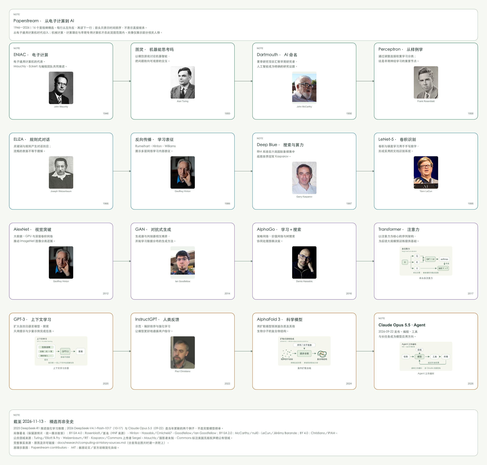

# Paperstream

**人用可视画布推演研究脉络，AI 用本地命令定点维护——共享同一份独立的 `.canvas` 文件。**

Paperstream 是基于开放标准 [JSON Canvas 1.0](https://jsoncanvas.org/spec/1.0/) 构建的**本地论文关系图编辑器（React Flow + ELK）与零依赖 Python 语义操作 API**。你可以在画布上直观组织论文核心认识、有向关系依据与关键图表；也可以把任务交给本地 AI Agent，按稳定 ID 安全增改节点与连线，不打乱人工排版与无关笔记。

> Paperstream 本身不内置大模型调用或提供模型账号，不自动联网查证论文，也不做实时无冲突共编。人机之间通过磁盘上的 `.canvas` 文件交接，切换操作前请先保存画布。

[为什么做 Paperstream](#为什么做-paperstream) · [核心特性](#核心特性) · [快速上手](#快速上手) · [人机协作与命令示例](#人机协作与命令示例) · [精选画布样例](#精选画布样例) · [多端接入与宿主支持](#多端接入与宿主支持) · [使用指南](docs/guide.md) · [API 参考](skills/paperstream/references/api.md) · [设计文档](docs/mechanisms/paperstream-design.md)



*宣传插画由 AI 生成，角色参考 ZipZipPipe（胖次狐）等社区拟人设定，详见[角色来源与生成记录](docs/assets/paperstream-classroom-promo-v4-prompt.md)（第三方角色设定不在项目 MIT 许可范围内，不代表任何官方背书）。*

## 为什么做 Paperstream

读到十几篇、几十篇论文时，书目管理工具、自动引文图与通用白板各自只解决了半截问题：

- **传统文献管理（如 Zotero）**：擅长存 PDF 与书目信息，难以在一张图上看清跨论文的方法演进、结构复用与技术分叉。
- **自动引文网络（如 Connected Papers）**：擅长按共引关系发现相似工作，但“引用 / 相似”不等于你精读后做出的机制判断（例如 `AlexNet → ResNet` 是残差学习缓解退化，`ResNet → Transformer` 是子层沿用残差连接，而 `Seq2Seq → Transformer` 才是序列建模转向注意力）。
- **让 AI 直接改通用白板 JSON**：缺少论文字段约束与按 ID 修改的机制，Agent 整文件重写极易丢掉手工坐标、覆盖未保存草稿、吞掉未知扩展字段，甚至编造年份和链接。

Paperstream 的设计围绕三件事收敛：**紧凑的学术卡片语义**、**受校验与版本锁保护的本地命令接口**，以及**不绑定云端账号的单文件资产**。


## 核心特性

### 可视画布与学术表达

- **三类画布元素**：
  - **论文卡片**：图面只保留高信噪比信息——`alias`（简称）、支持 `- ` 列表分点的 `takeaway`（核心认识）、可选关键插图，以及固定在右下角的版本 `year`；完整原题 `name` 与原文 `url` 收纳于点击卡片右上角文档图标或右键弹出的就近详情浮层，支持一键打开原文。卡片高度默认随内容自动伸缩，手动调整尺寸后也可保留留白。
  - **轻量批注（Note）**：随时插入自由便签，记录尚未解答的疑问、范围边界或阶段总结。
  - **共享关系标签**：多条连线可共用同一个关系说明节点，避免重复维护多份文本；拖动相连卡片时标签自动跟随重心移动。
- **可溯源的有向关系与精细路由**：支持自由说明或无字连线；支持正向 / 反向 / 双向 / 无箭头，实线 / 虚线 / 点线，以及实心 / 开放 / 菱形 / 圆点箭头；关系详情支持记录关系类别、多行原文依据（`evidence`）与人工权重（1–5），节点边框与连线线宽可在 0.5–8 px 间独立调节。自动标签会避让卡片，也可手动拖动固定坐标、在路径上增删控制折点（`Shift`+双击路径添加，双击或 `Delete` 删除折点）。
- **图表内嵌与无损肖像取景**：选中卡片直接 `Ctrl/Cmd+V` 粘贴或导入 PNG / JPEG / WebP（单图上限 **8 MB、3200 万像素、单边 16384 px**），拖拽右下角调整宽度（**15%–100%**）；支持原图、1:1 方形、3:4 肖像、完整方形及 **1–4 倍**缩放定位取景——只记录展示参数，不破坏原图字节与来源署名。
- **智能排版、局部聚焦与全图导出**：内置 **ELK Layered 智能竖排**（联合计算节点层级、正交折线与行内标签，支持撤销，排完保持手工布局）；支持搜索定位、**“附近”局部邻居过滤**、多文件页签（IndexedDB 草稿恢复）、**苔绿 / 纸白 / 夜间**三套主题与**直角 / 圆角 / 曲线**三种路径；支持导出包含视口外全部内容与取景效果的自包含 **SVG / PNG**。

### 开放文件格式与本地自动化内核


*[查看架构图 PNG](docs/assets/paperstream-architecture.png) · [Q 版头像来源与生成记录](docs/assets/paperstream-agent-avatars-prompt.md)（头像基于 ApprenTice 发布的社区拟人 Q 版派生图，适用 CC BY-NC-SA 4.0，不在项目 MIT 许可范围内）*

- **标准 JSON Canvas 1.0 单文件可迁移**：论文字段存于标准 `type: "text"` 卡片的 fenced JSON 代码块（`"paperstream": 1`），关系存于标准边 `label`，视觉与依据扩展分别保存在 `paperstreamCard` / `paperstreamStyle` / `paperstreamRelation`，粘贴图片以 data URL 内嵌于 JSON 中。完整保留普通文本卡、文件卡、链接、分组框、节点数组叠放顺序与未知扩展字段；可用 `export-canvas` 将旧版 `.mmd` 单向导出为 `.canvas`（详见[文件格式与迁移](docs/guide.md#文件格式与迁移)）。
- **零依赖 Python 标准库 API / CLI**：仅需 Python 3.10+，无任何第三方 Python 运行依赖。提供 `CanvasGraph` 与 `python3 -m paperstream` CLI 按稳定 ID 增删改查；基于读取时的磁盘快照（SHA-256 `source_revision`）、同目录协作锁与临时文件原子替换防止静默覆盖——遇到外部更改会明确报错（`ConflictError` / HTTP 409），保留原文件不强行覆盖。
- **可分发的标准作业 Skill**：仓库提供 [`skills/paperstream/`](skills/paperstream/SKILL.md) 及 [API 参考](skills/paperstream/references/api.md)，约束 Agent 严格执行“先读全图取稳定 ID → 按需定点修改 → 回读核验、缺失字段留空不编造”的工作流（分发时请带上整个 `skills/paperstream/` 目录）。

## 快速上手

### 方式一：独立浏览器工作台

需要 **Node.js 22.18+**。在仓库根目录运行：

```sh
npm ci --prefix web
npm --prefix web run dev
```

打开终端显示的本机地址，从文件菜单载入 `examples/` 下的样例或新建画布：

- **原位编辑**：双击简称、要点或关系文字直接编辑（单行 `Enter`、多行 `Ctrl/Cmd+Enter` 或失焦结束）。
- **插入与连线**：双击空白处或点底部“＋插入”添加论文、Note 或共享标签；拖动连接点建立关系。
- **图片与详情**：选中卡片后 `Ctrl/Cmd+V` 粘贴图片；点击卡片右上角文档图标或右键节点/连线打开就近详情浮层。
- **缩放与保存**：滚轮围绕光标缩放，拖动空白处平移；有效编辑即时进入当前文档，**写回磁盘仍需点击保存**。

### 方式二：单文件本地直连服务（`serve`）

适合把页面直接绑定到磁盘上某一个确定的 `.canvas` 文件，保存时走 `CanvasGraph` 校验与版本锁。构建前端一次需 **Node.js 22.18+**，运行时只需 **Python 3.10+**：

```sh
npm ci --prefix web
npm --prefix claude run build
python3 -m paperstream serve examples/resnet.canvas --read-only --port 3817
```

服务会在终端打印包含随机令牌的完整本机 URL（`http://127.0.0.1:3817/#token=...`），请打开**完整链接**（裸端口没有文件权限）。准备编辑自己的画布时，将路径替换为你的 `.canvas` 并去掉 `--read-only`。服务仅监听 `127.0.0.1` 且只授权启动时指定的文件，不提供目录浏览或任意路径读写。

## 人机协作与命令示例

人机协作遵循三步交接规程：**① 在画布保存当前文件**（磁盘 API 看不到未保存的 UI 草稿）→ **② 把文件路径、可靠论文资料与任务范围交给本地 Agent** → **③ 回到画布重载检视与微调**。

### CLI 定点读写（按稳定 ID）

```sh
# 1. 读取完整 Canvas 文档并取得真实节点 / 边 ID（paper_001 等以实际返回为准）
python3 -m paperstream show examples/resnet.canvas --raw
python3 -m paperstream validate examples/resnet.canvas

# 2. 对自己的文件按真实 ID 修改卡片与新增关系（示例 ID 请替换为实际值）
python3 -m paperstream update-node /path/to/papers.canvas ACTUAL_NODE_ID --alias 'ResNet'
python3 -m paperstream add-edge /path/to/papers.canvas ACTUAL_SOURCE_ID ACTUAL_TARGET_ID --relation '沿用残差连接'
```

每个 CLI 命令都会独立加载并保存一次；成功时 stdout 输出 JSON，失败时 stderr 输出结构化错误（业务/读写错误退出码 `1`，用法错误 `2`）。完整子命令见 `python3 -m paperstream --help`。

### Python `CanvasGraph` 批量原子修改

多个相关操作应在同一个 `CanvasGraph` 实例内完成，校验后一次性原子写入：

```python
from paperstream import CanvasGraph

with CanvasGraph.load("/path/to/papers.canvas") as graph:
    transformer = graph.add_node(
        "Transformer",
        "- 用自注意力替代循环与卷积实现并行序列建模\n- 在子层外使用残差连接",
        name="Attention Is All You Need",
        url="https://arxiv.org/abs/1706.03762v1",
        year=2017,
        x=320,
        y=480,
    )
    graph.add_edge("ACTUAL_RESNET_ID", transformer.id, "沿用残差连接")
    graph.validate()
# 正常退出 with 块时自动执行快照比对与原子保存；抛出异常则不会改写原文件
```

### 给本地 Agent 的任务模板

> 读取 `/path/to/papers.canvas`（使用 `show --raw`）和我提供的几篇论文官方资料：为新论文补一张卡片并写出 2–3 条核心认识，再连接到已有工作说明方法对比或结构复用关系。请务必通过 `paperstream` API/CLI 按 ID 修改，保留现有布局、Note 与未知字段，缺失的年份或链接留空不要猜测；完成后回读校验并告诉我实际修改的 ID。

更多命令细节与冲突处理规范见 [API 参考](skills/paperstream/references/api.md)、[Paperstream Skill](skills/paperstream/SKILL.md)、[仓库 Agent 约定](AGENTS.md)与[交互方式审查](docs/research/agent-interaction-audit.md)。

## 精选画布样例

仓库 `examples/` 目录随附 6 份经过 API 校验的 `.canvas` 示例，打开工作台后可直接另存为自己的副本试用：

| 样例文件 | 规模 | 适合用来了解什么 | 来源说明 |
| --- | --- | --- | --- |
| [resnet.canvas](examples/resnet.canvas) | 3 篇论文 · 2 条关系 | ResNet、DenseNet 与 ResNeXt 连接与残差块对比，适合首次上手编辑与试跑 CLI | — |
| [cnn-evolution.canvas](examples/cnn-evolution.canvas) | 4 篇论文 · 3 条关系 | LeNet-5 → AlexNet ↔ VGG → ResNet 经典卷积演进（含双向对照关系） | — |
| [deeph-reading.canvas](examples/deeph-reading.canvas) | 4 篇论文 · 3 条关系 | 从 DFT 理论基础到 DeepH / DeepH-E3 等变神经网络的专题阅读路线 | — |
| [quantum-foundations.canvas](examples/quantum-foundations.canvas) | 6 篇论文 · 5 条关系 | 1925–1964 量子力学奠基原始文献脉络与概念对照 | — |
| [deep-learning-history.canvas](examples/deep-learning-history.canvas) | 17 张卡片（14 篇论文 + 3 张说明）· 8 条关系 | 1986–2022 深度学习关键路线、关系依据与统一 3:4 取景肖像 | [深度学习来源表](docs/research/deep-learning-history-sources.md) |
| [computing-ai-history.canvas](examples/computing-ai-history.canvas) | 18 张卡片（16 个里程碑 + 2 张说明）· 12 条连线 | 1946–2026 从电子计算到现代 AI 精选导览与人物肖像 | [计算机与 AI 来源表](docs/research/computing-ai-history-sources.md) |


<details>
<summary>展开查看导出整图：从电子计算到 AI（1946–2026）</summary>



</details>

*历史样例中的论文版本口径与肖像摄影署名分别记录在[深度学习来源表](docs/research/deep-learning-history-sources.md)与[计算机与 AI 来源表](docs/research/computing-ai-history-sources.md)。**分享这两份历史画布或导出 PNG/SVG 时，请一并附上对应来源表**（人物照片保留各自 Wikimedia Commons 许可，不由项目 MIT 许可覆盖）。*

## 多端接入与宿主支持

几类入口复用同一 React Flow 编辑器与同一份 `.canvas` 格式，按你的工作环境选择：

| 入口 | 运行环境要求 | 接入方式 | 当前验收状态 | 详细文档 |
| --- | --- | --- | --- | --- |
| 独立浏览器（`web/`） | Node.js 22.18+ | 多页签工作台，支持 File System Access 句柄写回或下载保存 | 已在本机浏览器实测 | [使用指南](docs/guide.md#开始使用) |
| 单文件本地桥（`paperstream serve`） | Python 3.10+（构建前端需 Node.js 22.18+） | `127.0.0.1` 单文件 HTTP 桥，Bearer 令牌认证 + `If-Match` 防冲突 | 已在普通浏览器实测读写与冲突保留 | [使用指南](docs/guide.md#直接绑定一份本地文件) |
| DSH Web 主面板（`dsh/`） | `@deepseek-ai/dsh@0.2.2-rc.1`、Node.js 24.9+ | 复用宿主 React 挂载左侧导航与主面板，支持宿主偏好落盘与本机打开原文 | macOS / Chrome / DSH Web 0.2.2-rc.1 已实测（Desktop 待验） | [DSH 插件说明](dsh/README.md) |
| ChatGPT / Codex 桌面文件面板（`codex/`） | Node.js 22.18+（Agent CLI 另需 Python 3.10+） | 基于 MCP Apps 与 OpenAI `openai/resource` 扩展的原生侧栏 `.canvas` 编辑器 | 本机 Codex 桌面会话已实测编辑、撤销、写盘、外改刷新与冲突保护 | [Codex 插件说明](codex/README.md) |
| Claude Code 本地插件（`claude/`） | 便携包运行仅需 Python 3.10+ | 面向 **Claude Code**（终端 CLI 或桌面端 Code 本地会话）：内置 Skill 调用本地 Python CLI 改图，`/paperstream:open` 启动单文件本地网页桥 | 本地打包、官方 `plugin validate --strict` 与 HTTP 读写冲突已测；真实账号会话待验。**注：不含 MCP Server，不支持在普通 Claude App 对话窗或文件侧栏原生内嵌打开 `.canvas`** | [Claude Code 说明](claude/README.md) |

更多宿主约束与验收明细见[宿主支持与验收范围](docs/guide.md#宿主支持与验收范围)及[开源前验收记录](docs/mechanisms/paperstream-design.md#开源前验收2026-11-13)。

## 仓库结构

```text
├── paperstream/        # 零依赖 Python 3.10+ 标准库 API（CanvasGraph / 旧 Mermaid Graph）、CLI 与单文件本地桥
├── web/                # React Flow + ELK 核心编辑器源码与独立多页签工作台
├── dsh/                # DeepSeek Harness (DSH) Web 主面板插件适配
├── codex/              # ChatGPT / Codex 桌面端 MCP Apps 文件编辑器插件
├── claude/             # Claude Code 本地插件（/paperstream:open 本地桥 + 便携打包）
├── skills/paperstream/ # 可独立分发的 Agent Skill 与 API 参考手册
├── examples/           # 精选 .canvas 示例与历史 .mmd 档案
├── docs/               # 使用指南、设计机制、交互审查与图片素材/来源表
└── tests/              # Python 单元测试与 CLI / 本地桥回归测试
```

## 开发与测试

在仓库根目录运行核心检查（更多前端、DSH、Codex、Claude 构建与验收步骤见[开发与验证](docs/guide.md#开发与验证)）：

```sh
python3 -m unittest discover -s tests -v   # Python API、CLI 与本地桥测试（93 项）
npm ci --prefix web
npm --prefix web test                      # 前端格式、布局与编辑器核心单元测试
npm --prefix web run test:interop          # Python / TypeScript JSON Canvas 往返一致性检查
npm --prefix web run build
```

## 许可与参与

- **自有代码与文档**：采用 [MIT License](LICENSE)（Copyright (c) 2026 Paperstream contributors）。
- **第三方素材与依赖**：打包的前端依赖（含 `elkjs` 的 EPL-2.0、MCP 相关过渡声明等）、历史人物肖像以及社区拟人角色素材各自保留原有许可与署名要求，详见[第三方声明](THIRD_PARTY_NOTICES.md)。

欢迎提交 Issue 或 PR 分享你的研究画布工作流或修补细节缺陷。反馈问题时请附上复现步骤、运行宿主/版本以及脱敏后的最小 `.canvas` 示例，切勿提交本地访问令牌、私人草稿或受版权限制的论文附件。实现演进与设计取舍持续记录在[设计文档](docs/mechanisms/paperstream-design.md)。
